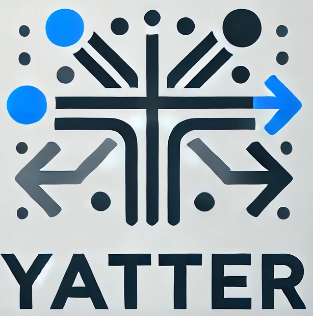

# YATTER
<p align="center">
  
</p>


[](https://github.com/citiususc/yatter/actions/workflows/testgha.yml)
[](https://doi.org/10.5281/zenodo.7024500)
[](https://pypi.org/project/yatter)

[](https://codecov.io/gh/citiususc/yatter)

The tool translates mapping rules from YARRRML in a turtle-based serialization of RML or R2RML.

## Installation:
```
pip install yatter
```

## Execution from CLI
To execute from command line run the following:

- From YARRRML to \[R2\]RML
```bash
python3 -m yatter -i path_to_input_yarrrml.yml -o path_to_rdf_mapping.ttl [-f R2RML]
```

- From \[R2\]RML to YARRRML 
```bash
python3 -m yatter -i path_to_input_rdf_mapping.ttl -o path_to_output_yarrrml.yml [-f R2RML]
```

`-f` selects the profile for either direction:

- `RML` (default): the current RML-Core vocabulary,
  `http://w3id.org/rml/`.
- `RML-OLD`: the previous RML vocabulary, for compatibility.
- `R2RML`: R2RML.

The new profile supports the implemented RML-IO, FNML and collection features;
RML-Star and Logical Views are not supported in this profile. Existing
RML-Star mappings can still use `RML-OLD`.

## Execution as a library

If you want to include the module in your implementation:
- for translating **YARRRML mapping** to **RML mappings** (and inverse):
```python
import yatter
from rdflib import Graph
from ruamel.yaml import YAML
# YARRRML to RML
yaml = YAML(typ='safe', pure=True)
with open("path-to-yarrrml.yml") as mapping_file:
    yarrrml_mapping = yaml.load(mapping_file)
rml_content = yatter.translate(yarrrml_mapping)
# RML to YARRRML
rml_graph = Graph().parse("path-to-rml-mapping.ttl", format="turtle")
yarrrml_content = yatter.inverse_translate(rml_graph)
```
- for the previous RML profile, pass its namespace explicitly in either direction:
```python
from yatter.constants import RML_OLD_NAMESPACE

rml_content = yatter.translate(yarrrml_mapping, mapping_format=RML_OLD_NAMESPACE)
yarrrml_content = yatter.inverse_translate(rml_graph, mapping_format=RML_OLD_NAMESPACE)
```
`RML_NAMESPACE` identifies the current vocabulary; `RML_OLD_NAMESPACE` identifies
the previous one. The former `_URI` namespace names remain available as aliases.
Code that used `RML_URI` for legacy RML must use `RML_OLD_NAMESPACE`.
Vocabulary term constants now contain full IRIs rather than prefixed names; Turtle
output remains prefixed and human-readable.
- for translating **YARRRML mappings** to **R2RML mappings** (and inverse):
```python
import yatter
from ruamel.yaml import YAML
from yatter.constants import R2RML_NAMESPACE

# YARRRML to R2RML
yaml = YAML(typ='safe', pure=True)
with open("path-to-yarrrml.yml") as mapping_file:
    yarrrml_mapping = yaml.load(mapping_file)
rml_content = yatter.translate(yarrrml_mapping, mapping_format=R2RML_NAMESPACE)
# R2RML to YARRRML
r2rml_graph = Graph().parse("path-to-r2rml-mapping.ttl", format="turtle")
yarrrml_content = yatter.inverse_translate(r2rml_graph, mapping_format=R2RML_NAMESPACE)
```
- for merging TriplesMap based on id:
```python
import yatter
from ruamel.yaml import YAML

yaml = YAML(typ='safe', pure=True)
list_yarrrml_mappings = []
for mapping_path in ["mapping1.yml", "mapping2.yml"]:
    with open(mapping_path) as mapping_file:
        list_yarrrml_mappings.append(yaml.load(mapping_file))
yarrrml_content = yatter.merge_mappings(list_yarrrml_mappings)
```

## Specifications conformant:

These are the following specifications used by the translation process:
- YARRRML: https://w3id.org/kg-construct/yarrrml
- R2RML: https://www.w3.org/TR/r2rml/ 
- RML-Core: https://kg-construct.github.io/rml-core/spec/docs/
- Previous RML: https://rml.io/specs/rml/
- RML-star (previous RML profile): https://w3id.org/rml/star/spec
- RML-IO: https://w3id.org/rml/io/spec
- RML-FNML: https://w3id.org/rml/fnml/spec
- RML-CC: https://w3id.org/rml/cc/spec

SQL sources in the new profile require an access description; database type
and credentials are optional. Existing `rml:` prefix declarations for the previous
namespace must be renamed or removed when selecting RML-Core. Inverse translation
rejects some unsupported constructs rather than silently discarding them, including
typed or language-tagged constant literals, multiple logical targets on one
term map, and file-source options such as encoding and compression.


## Cite this work:
If you used Yatter in your work, please cite the [ICWE2023](https://icwe2023.webengineering.org/program/) [paper](http://davidchavesfraga.com/outcomes/papers/2023/iglesias2023yatter.pdf):

```bib
@inproceedings{iglesias2023human,
  title={Human-Friendly RDF Graph Construction: Which One Do You Chose?},
  author={Iglesias-Molina, Ana and Chaves-Fraga, David and Dasoulas, Ioannis and Dimou, Anastasia},
  booktitle={International Conference on Web Engineering},
  pages={262--277},
  year={2023},
  doi={10.1007/978-3-031-34444-2_19},
  organization={Springer}
}
```

## Authors
CiTIUS - Universidade de Santiago de Compostela (2023-now):
- [David Chaves-Fraga](mailto:david.chaves@usc.es)
- Rubén Buján Vide (Final bachelor thesis - Mapping normalization, RML-cc and library management)

Ontology Engineering Group - Universidad Politécnica de Madrid (2021-2023):
- David Chaves-Fraga
- Marino González García (Final bachelor thesis - Systematic Testing)
- Luis López Piñero (Final bachelor thesis - v0.1)


